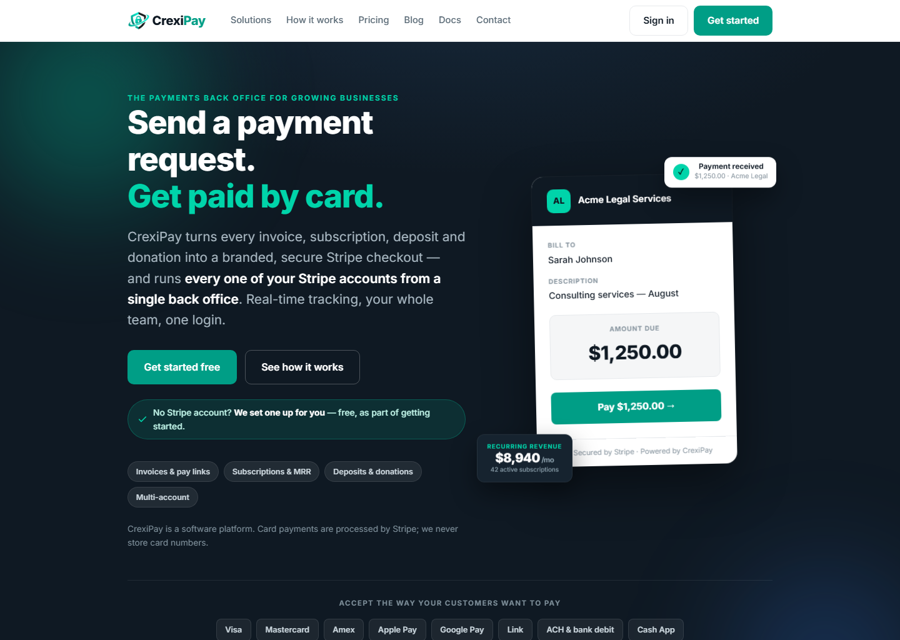
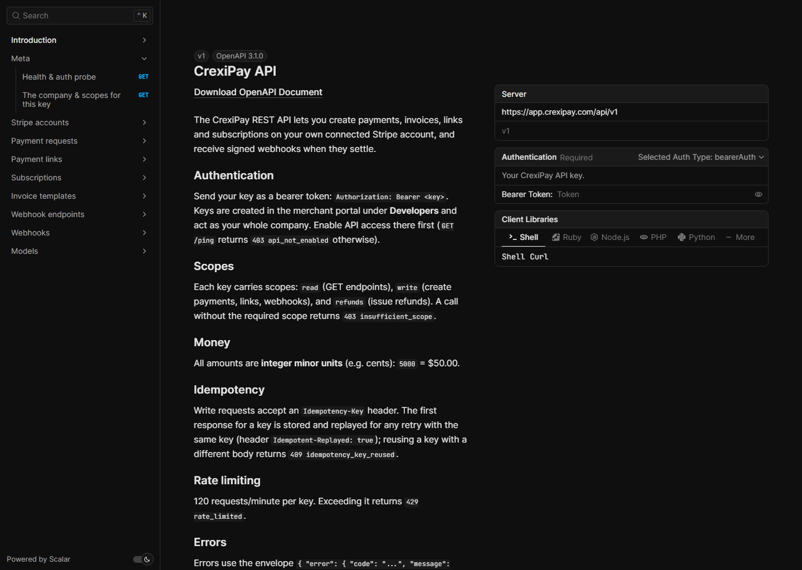
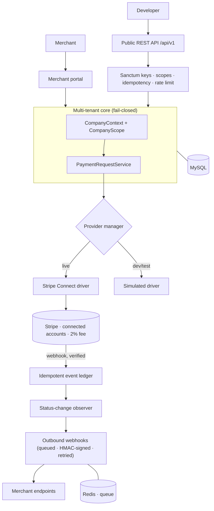

<p align="center">
  
</p>

<h1 align="center">CrexiPay — Case Study</h1>

<p align="center">
  <b>A multi-tenant payments &amp; invoicing SaaS built on Stripe Connect.</b><br>
  Laravel 13 · PHP 8.3 · MySQL · Redis · Stripe Connect · Tailwind + Alpine
</p>

---

CrexiPay lets a business connect its **own** Stripe account in one click and then run its
whole billing operation from a single back office — branded invoices, reusable payment
links, deposits, donations and subscriptions — with a flat platform fee collected
automatically on every charge. It ships with a complete **public REST API** (scoped keys,
idempotency, signed webhooks and interactive docs) so merchants can build on top of it.

This repository is a **portfolio case study**: a public overview of the architecture and
engineering. The full application source is private and available to reviewers on request.

> **Status:** live in production as a real payments platform.

---

## The product

<p align="center">
  
</p>

**What merchants can do**

| | |
|---|---|
| **One-click onboarding** | Connect an existing Stripe account via Connect OAuth — no keys to copy. The 2% platform fee is taken with `application_fee_amount` on every charge. |
| **Invoices & payment requests** | Itemized line items, SKUs, %/fixed discounts, tax, notes; a branded hosted pay page that hands off to Stripe. |
| **Deposits** | Collect part of a total now, bill the balance later. |
| **Payment links** | Fixed-price or pay-what-you-want, with suggested amounts, QR codes and embeds. |
| **Subscriptions** | Recurring plans with the fee applied to every invoice, plus a self-serve customer billing portal. |
| **Refunds** | Issued on the connected account, from the portal or the API. |
| **Dashboards** | Fees, volume, MRR, refunds/chargebacks, per-account breakdowns, CSV exports, real-time web-push notifications. |

**What developers can do** — a full REST API: company-scoped keys with `read` / `write` /
`refunds` scopes, idempotent writes, per-key rate limiting, and outbound **signed
webhooks** with retries. Documented with an OpenAPI 3.1 spec and an interactive reference.

<p align="center">
  
</p>

---

## Architecture



### Engineering highlights

**Fail-closed multi-tenancy.** Every tenant-owned model adds a global scope and stamps its
`company_id` from an ambient context. With no resolved company the scope yields *zero*
rows, never all — isolation is the default, and crossing tenants is an explicit, auditable
operation. The API authenticates a **Company** and binds that context for the whole request.

```php
// Applied to every tenant model — the security boundary, once.
static::addGlobalScope(new CompanyScope);        // WHERE company_id = <current tenant>
// No tenant in context? Return nothing, not everything.
```

**One payment pipeline, three drivers.** A provider seam resolves each account to
`stripe_connect` (live, collects the fee), `stripe` (legacy BYO-key), or `simulated`
(drives the full flow with no Stripe call — used for tests and local dev). Every payment
type flows through the same pipeline, so fees, webhooks, dashboards and reporting apply with
no special cases.

**Money is integer minor units, everywhere.** bcmath integer math with fees floored in the
merchant's favour; no float ever touches a currency value.

**A public API that behaves like one.** Built in phases — foundation & keys, read, write
with idempotency and guarded refunds, outbound webhooks, and docs:

- **Idempotency keys** on writes — the first response is stored and replayed for any retry;
  reusing a key with a different body is rejected.
- **Signed webhooks** — a Stripe-style HMAC over `"{timestamp}.{body}"`, delivered by a
  queued job that retries with backoff and logs every attempt.

```php
// Outbound webhook signature — verify in constant time, reject stale timestamps.
$v1 = hash_hmac('sha256', "{$t}.{$body}", $endpoint->secret);
// Header:  CrexiPay-Signature: t=<unix>,v1=<hex>
```

- **Stable envelope** — `{data}` on success, `{error:{code,message}}` on failure, with
  machine-readable codes (`insufficient_scope`, `validation_failed`, `rate_limited`, …).
- **OpenAPI 3.1** served from the app and rendered as an interactive reference with a
  try-it-out console that calls the API **same-origin** (so a key never leaves the origin).

---

## Tech stack

- **Backend:** PHP 8.3, Laravel 13, Laravel Sanctum
- **Data:** MySQL 8 (tenant data), Redis (cache, sessions, queue + worker)
- **Payments:** Stripe Connect (Standard, direct charges) via `stripe/stripe-php`
- **Frontend:** Tailwind CSS v4 + Alpine.js, built with Vite; an installable PWA with web push
- **API docs:** OpenAPI 3.1 + Scalar
- **Testing:** PHPUnit feature/unit suites (the simulated provider exercises the full flow)

---

## About

Designed and built by **Jessie Martin**.

- 📧 [nvitguru@gmail.com](mailto:nvitguru@gmail.com)
- The complete source is maintained privately and can be shared with reviewers on request.

---

<sub>© 2026 Jessie Martin. All rights reserved. This case study is for evaluation of the
author's work. "CrexiPay" branding and the Stripe name belong to their respective owners;
Stripe is used for payment processing and CrexiPay never stores card numbers. See
<a href="LICENSE">LICENSE</a>.</sub>
